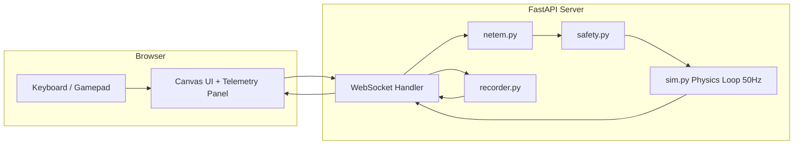

# PLAN.md - teleop-console-demo

Author: Arpan Bom, senior robotics/AI engineer (human-in-the-loop humanoid control, drones on Jetson/Raspberry Pi with web mission control)

Status: demo/simulation only, not production software

## 1. Purpose

A small, runnable portfolio project showing a browser-based teleoperation console driving a simulated differential-drive robot over WebSocket, with the safety, networking, and observability patterns used in real teleop systems: e-stop, deadman switch, watchdog, rate limiting, and simulated network degradation. Everything runs in a single process, no external services, no real hardware.

## 2. Honesty statement

This is a simulation demo built to show engineering patterns, not a production teleop stack. The "robot" is a 2D kinematic model in a Python process. There is no real-time OS, no certified safety system, no camera, and no physical actuator in the loop. Latency, jitter, and packet loss are synthetic and applied in software. Treat the safety features (e-stop, deadman, watchdog) as illustrations of the pattern, not as a substitute for a certified safety system on real hardware.

## 3. Stack

- Python 3.11+, FastAPI, uvicorn, native WebSocket (`fastapi.WebSocket`)
- Pure Python math for kinematics and ray casting; numpy optional, not required
- Frontend: single static page, vanilla JS, HTML canvas, no build step, served by FastAPI via `StaticFiles`
- pytest for tests, `TestClient` for integration/websocket tests
- Dockerfile, docker-compose.yml, Makefile
- GitHub Actions CI running pytest
- MIT license

Run options:
- `make run`
- `docker compose up`
- `pip install -r requirements.txt && python -m teleop.server`

## 4. Repository layout

```
teleop-console-demo/
  teleop/
    __init__.py
    server.py          # FastAPI app, routes, websocket handler, main loop wiring
    sim.py             # differential-drive kinematics, world/obstacles, lidar raycasting
    safety.py          # e-stop latch, deadman switch, watchdog, velocity clamp, rate limiter
    netem.py           # latency/jitter/packet-loss emulation for the command path
    recorder.py        # JSONL session recording and replay
    messages.py        # message envelope + ROS2-style topic schemas
  web/
    index.html
    app.js
    style.css
  tests/
    test_sim.py
    test_safety.py
    test_netem.py
    test_recorder.py
    test_integration_ws.py
  recordings/           # .gitkeep, runtime output directory
  docs/
    screenshot.png
  .github/workflows/ci.yml
  Dockerfile
  docker-compose.yml
  Makefile
  requirements.txt
  README.md
  LICENSE
  PLAN.md
```

## 5. Module responsibilities

### teleop/messages.py
- Defines the envelope: `{"topic": str, "stamp": float, "data": dict}`
- Topic constants: `/cmd_vel`, `/odom`, `/scan`, `/battery_state`, `/diagnostics`
- Dataclasses/dicts for each payload shape (see schemas below)
- Helper `make_message(topic, data) -> dict` that stamps with `time.time()`

### teleop/sim.py
- `World`: fixed-size 2D arena, list of rectangular/circular obstacles
- `Robot`: pose `(x, y, theta)`, linear/angular velocity, wheel-base differential-drive kinematics update `step(dt)`
- Collision detection: circle-vs-obstacle check after each integration step; on collision, zero velocity and clamp position to last valid pose
- Lidar: `scan(robot, world, n_rays=180, max_range)` returns list of ranges via ray-marching/line-segment intersection against obstacles and arena walls
- Battery model: starts at 100 percent, drains proportional to commanded speed and time, never recovers (demo simplicity)
- `PhysicsLoop`: runs at fixed 50 Hz using `asyncio` task with a monotonic-clock accumulator so steps stay fixed-size even under scheduling jitter

### teleop/safety.py
- `EstopLatch`: `trigger()`, `reset()`, `is_active`, latches until explicit reset
- `Deadman`: tracks last-seen "deadman held" flag per client, commands ignored when false
- `Watchdog`: tracks last command timestamp, `is_stale(now, timeout=0.3)`, server stops robot if stale
- `RateLimiter`: token-bucket or fixed-window limiter, max 30 Hz per client, returns accept/drop, keeps a dropped-count
- `clamp_velocity(linear, angular, limits)` pure function

### teleop/netem.py
- `NetworkConditions`: `latency_ms`, `jitter_ms`, `loss_pct`, updatable at runtime
- `apply(message) -> Optional[delayed_delivery]`: decides drop (random against `loss_pct`), computes delay = `latency_ms + random(-jitter_ms, jitter_ms)` clamped to >= 0
- Implemented as an async delay queue per connection so delayed commands are delivered later without blocking the physics loop
- Server measures and reports actual applied delay as part of RTT so the UI can show "measured RTT" versus the slider inputs

### teleop/recorder.py
- `Recorder`: appends every inbound command and outbound telemetry message as JSONL line `{"topic", "stamp", "data"}` to `recordings/<session_id>.jsonl`
- `list_recordings() -> list[dict]` (id, start time, size, message count)
- `Replayer`: reads a JSONL file and yields messages paced by original stamp deltas (or as fast as possible with a flag), used by a replay-only websocket/REST flow that feeds recorded telemetry back to the UI without touching the live sim

### teleop/server.py
- FastAPI app, mounts `web/` as static root at `/`
- Operator lock: first websocket connection becomes operator; later connections are observers (receive telemetry, commands from them are rejected with a diagnostic message)
- Websocket handler: receives `/cmd_vel`-topic messages from operator, routes through netem -> rate limiter -> deadman/estop/watchdog checks -> sim
- Telemetry broadcast task at 20 Hz: sends `/odom`, `/scan`, `/battery_state`, `/diagnostics` to all connected clients
- Ping/pong round trip measured per client for displayed RTT
- REST endpoints:
  - `GET /api/health`
  - `GET /api/state` (current pose, battery, estop state, connected clients)
  - `POST /api/estop` (trigger latch)
  - `POST /api/reset` (reset estop, respawn robot, reset battery)
  - `POST /api/network` (`latency_ms`, `jitter_ms`, `loss_pct`)
  - `GET /api/recordings`, `GET /api/recordings/{id}`
  - `POST /api/replay/{id}` (start a replay session), `POST /api/replay/stop`

## 6. Message schemas (JSON envelope)

```
{"topic": "/cmd_vel", "stamp": 1732000000.123,
 "data": {"linear": 0.5, "angular": -0.2, "deadman": true}}

{"topic": "/odom", "stamp": ...,
 "data": {"x": 1.2, "y": 0.4, "theta": 0.78, "v": 0.5, "w": -0.2}}

{"topic": "/scan", "stamp": ...,
 "data": {"angle_min": -3.14, "angle_max": 3.14, "ranges": [..]}}

{"topic": "/battery_state", "stamp": ...,
 "data": {"percentage": 87.3, "voltage": 11.8}}

{"topic": "/diagnostics", "stamp": ...,
 "data": {"estop": false, "watchdog_tripped": false, "link": "ok",
          "cmd_rate_hz": 18.2, "dropped_cmds": 3, "rtt_ms": 42}}
```

## 7. Control loop design

- Physics loop: `asyncio` task, fixed 50 Hz step using accumulator pattern (`while True: sleep(remaining); step(dt_fixed)`), decoupled from network/render rate
- Command path: operator websocket receive -> netem delay queue -> rate limiter -> safety checks (estop, deadman, watchdog freshness) -> velocity clamp -> applied to `Robot` target velocity
- Telemetry path: separate 20 Hz broadcast task reads current sim state and pushes to all connected clients independent of command cadence
- Watchdog check happens inside the physics step itself (not just on command receipt): if `now - last_accepted_cmd_time > 0.3s`, force velocity to zero regardless of last commanded value
- Operator/observer distinction enforced at the websocket handler, not in the sim

## 8. Frontend (web/)

- `index.html`: canvas for top-down view, lidar overlay toggle, telemetry panel, network sliders (latency/jitter/loss), e-stop button, recording controls, connection status
- `app.js`: websocket client, keyboard input (WASD/arrows), Gamepad API polling, deadman via held Shift or gamepad button, renders robot + obstacles + lidar rays on canvas, updates telemetry panel at message rate, sends ping messages for RTT measurement
- `style.css`: minimal dark console theme

## 9. Tests (pytest)

- `test_sim.py`: differential-drive kinematics correctness (straight line, pure rotation, arc), collision detection against a known obstacle, lidar ray hits a wall at expected range
- `test_safety.py`: e-stop latches until reset, deadman blocks commands when not held, watchdog zeroes velocity after timeout, rate limiter drops excess commands above 30 Hz and counts them, velocity clamp caps at configured limits
- `test_netem.py`: zero settings pass through unchanged, loss_pct=100 drops all messages, latency/jitter produce delay within expected bounds (statistical/bounded check, not exact)
- `test_recorder.py`: recorded JSONL round-trips through replayer with correct message count and ordering, `list_recordings` reflects files on disk
- `test_integration_ws.py`: using FastAPI `TestClient` websocket, first connection becomes operator, second becomes observer, sending `/cmd_vel` moves the robot in subsequent `/odom` messages, `POST /api/estop` halts motion, `GET /api/health` returns ok

## 10. README outline

1. One-line pitch + screenshot (`docs/screenshot.png`)
2. "This is a simulation demo" honesty section
3. Quickstart (`make run` / `docker compose up` / pip+module)
4. Architecture diagram (mermaid, see below)
5. Feature list (safety, netem, recording/replay, dual control input)
6. REST and websocket API reference
7. "How this maps to real robots" section:
   - Swap `sim.py` physics for a ROS 2 bridge node (`rclpy`) publishing/subscribing the same topic names, so the UI and safety layer are unchanged
   - Replace canvas camera view with a WebRTC video stream from an onboard camera
   - Deploy the console/safety server on a Jetson or Raspberry Pi as the robot-side edge node, with the browser as a thin remote client over the same netem-aware link
   - Watchdog/deadman/estop patterns here mirror what you'd wire to a real motor controller's enable line, just without hardware-certified fail-safes
8. Running tests, CI badge
9. License

Mermaid diagram (in README):



## 11. CI

`.github/workflows/ci.yml`: on push/PR, set up Python 3.11, `pip install -r requirements.txt`, run `pytest -q`.

## 12. Docker / Makefile

- `Dockerfile`: slim python base, copy `teleop/` and `web/`, install requirements, `CMD ["python", "-m", "teleop.server"]`
- `docker-compose.yml`: single service, port 8000 exposed, mounts `recordings/` as a volume
- `Makefile`: targets `run`, `test`, `docker-build`, `docker-up`, `fmt` (optional)

## 13. Acceptance criteria checklist

- [ ] `make run` or `docker compose up` starts the server with no manual steps
- [ ] Browser UI loads at `/`, shows robot, obstacles, and lidar rays updating live
- [ ] Keyboard and Gamepad API both drive the robot
- [ ] Deadman switch required to move the robot, release stops it
- [ ] E-stop button halts the robot and stays latched until reset
- [ ] No command for 300 ms stops the robot (watchdog)
- [ ] Sending commands faster than 30 Hz results in visible dropped-command count
- [ ] Network sliders change measured RTT and visibly affect responsiveness
- [ ] Second browser tab connects as observer, cannot send commands
- [ ] Session recording produces a JSONL file, listed via REST, replayable from UI
- [ ] `pytest` passes locally and in CI
- [ ] README includes honesty section, architecture diagram, and real-robot mapping section
- [ ] MIT license present

## 14. Implementation notes

- Recording control: `POST /api/recordings/start` and `POST /api/recordings/stop` in addition to list/get. UI has Record / Stop / Replay buttons and a recordings dropdown.
- Use an app factory `create_app(start_loops: bool = True)` so tests can run deterministic sim steps without wall-clock loops where needed; the integration test may still use real loops with short waits.
- Ping/pong: client sends `{"topic": "/ping", "data": {"id", "t"}}`; server echoes `/pong` through the same netem path so measured RTT reflects simulated latency.
- Deadman release or link loss must stop the robot immediately (zero target velocity), not only after the watchdog.
- Replay mode shows a clear "REPLAY" banner in the UI and blocks live commands while active.
- Pin dependency versions in requirements.txt (fastapi, uvicorn[standard], httpx, pytest). Server listens on 0.0.0.0:8000, port configurable via `PORT` env.
- No em dashes or en dashes in any file.
