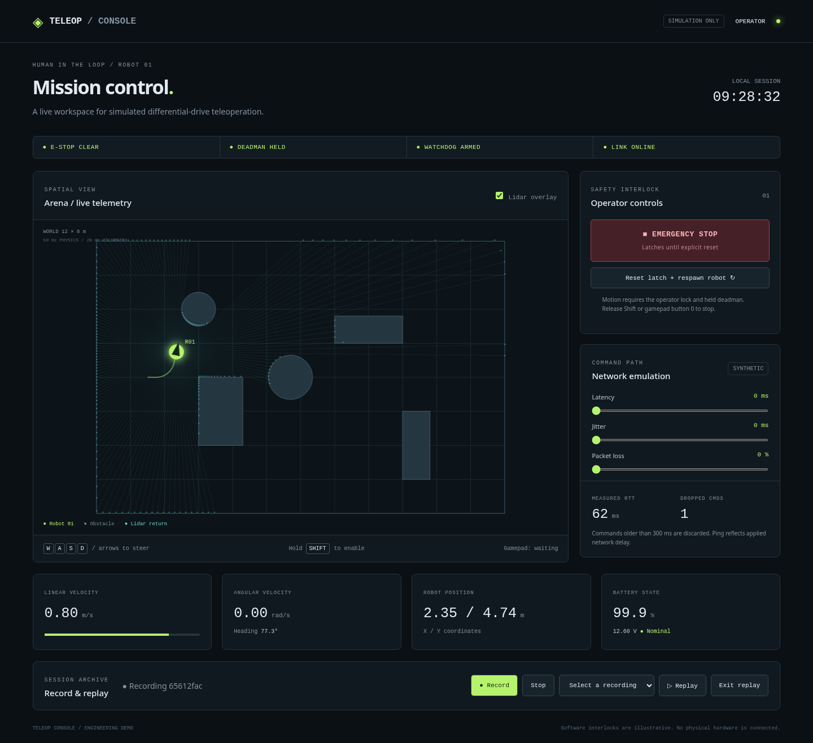
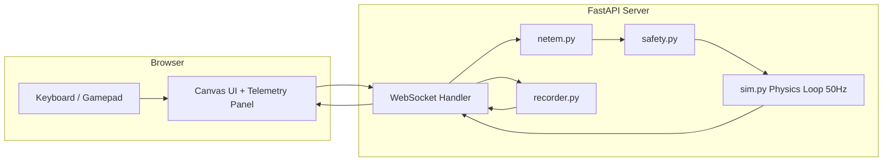

# Teleop Console Demo

[](https://github.com/applycoding/teleop-console-demo/actions/workflows/ci.yml)

A browser mission console driving a simulated differential-drive robot, with visible safety interlocks, synthetic network degradation, and session replay.



| Input | Action |
| --- | --- |
| Hold Shift | Deadman (required to move) |
| WASD or arrow keys | Drive while deadman held |
| Space | Emergency stop |
| Gamepad button 0 + left stick | Drive while deadman held |

## Honesty: this is a simulation demo

This is a simulation demo built to show engineering patterns, not a production teleop stack. The robot is a 2D kinematic model in a Python process. There is no real-time OS, certified safety system, camera, or physical actuator in the loop. Latency, jitter, and packet loss are synthetic and applied in software. E-stop, deadman, and watchdog illustrate patterns and are not substitutes for certified safety systems on real hardware. Collision checks happen after each integration step; they are not continuous collision detection. The application has no authentication and is intended for local demonstration on a trusted machine.

## Quickstart

Requires Python 3.11+ or Docker Compose. Open http://localhost:8000 after starting.

```sh
make run
```

Or use a virtual environment:

```sh
python3 -m venv .venv
. .venv/bin/activate
pip install -r requirements.txt
python -m teleop.server
```

Or run the container:

```sh
docker compose up --build
```

`PORT` configures the Python server port (default 8000). Compose publishes port 8000 and persists JSONL files in `recordings/`. `make run` installs requirements before starting, selecting `.venv/bin/python` when available.

## Controls and features

- The first WebSocket connection gets the operator lock. Other tabs observe telemetry and cannot drive. When the operator disconnects, the oldest remaining connection is promoted.
- Release the deadman, leave the tab, or lose the link to stop motion. Browser Gamepad API availability depends on browser support and a secure context; localhost is suitable.
- Emergency stop immediately zeros velocity and latches until Reset. Reset also respawns the robot and restores the battery.
- A watchdog runs in the physics step and stops motion after 300 ms without an accepted command. Commands older than 300 ms in the delay queue are discarded.
- Per-client commands are limited to 30 Hz. The UI sends at 20 Hz. Diagnostics show rate-limit and synthetic-loss drops.
- Latency, jitter, and loss sliders affect commands and ping echoes. Measured RTT is browser ping-to-pong elapsed time, including one synthetic delay on the echoed ping path. It is not twice the latency slider. Settings above the freshness window deliberately prevent motion.
- Fixed 50 Hz physics and independent 20 Hz telemetry, circle collisions, rectangular and circular obstacles, geometric lidar, robot trail, and a speed-dependent battery model.
- Record starts an append-only JSONL session. Stop saves it and refreshes the archive selector. Replay plays recorded telemetry with original timing, shows a REPLAY banner, and blocks live commands. Exit replay returns to live telemetry. Replay never applies recorded commands to the robot.

## Architecture



The command path is operator validation, async network queue, freshness check, rate limit, safety checks, velocity clamp, then simulation. Deadman release bypasses loss and delay and invalidates queued commands. E-stop, reset, replay transitions, and operator loss also invalidate queued motion. The watchdog uses monotonic server time, not the untrusted envelope timestamp. Physics uses a fixed-step monotonic accumulator. Telemetry sends have a bounded timeout so a stalled browser cannot indefinitely hold broadcasting.

## API

REST uses JSON. WebSocket endpoint: `/ws`. Envelope: `{"topic": str, "stamp": float, "data": object}`.

| Method | Endpoint | Notes |
| --- | --- | --- |
| GET | `/api/health` | Liveness and `simulation: true` |
| GET | `/api/state` | Pose, battery, e-stop, clients, replay, world, `network` |
| POST | `/api/estop` | Latch e-stop |
| POST | `/api/reset` | Clear latch, respawn robot |
| POST | `/api/network` | Body: `latency_ms`, `jitter_ms`, `loss_pct` (each defaults to 0) |
| GET/POST | `/api/recordings` | List, start, stop; GET `/{id}` downloads JSONL |
| POST | `/api/replay/{id}` | Paced telemetry replay; POST `/api/replay/stop` ends it |

**WebSocket topics:** `/cmd_vel` (in, `linear`, `angular`, `deadman`, clamped to +/-1 m/s and +/-2 rad/s), `/odom`, `/scan` (180 ranges), `/battery_state`, `/diagnostics`, `/ping` and `/pong`. Invalid commands get a diagnostic `reason`. Recordings store operator commands and outbound telemetry (not ping or connect events). UI RTT is browser ping/pong elapsed time; diagnostics `rtt_ms` is server queue delay only.

## How this maps to real robots

Swap `sim.py` physics for a ROS 2 bridge node using `rclpy`, publishing and subscribing to the same topic names, so the UI and safety layer keep their interfaces. Replace the canvas camera view with a WebRTC video stream from an onboard camera. Deploy the console and safety server on a Jetson or Raspberry Pi as the robot-side edge node, with the browser as a thin remote client over the same netem-aware link. Watchdog, deadman, and e-stop mirror patterns wired to a motor controller enable line, but real systems require independently engineered hardware fail-safes, authentication, and deployment-specific safety validation.

## Tests and CI

```sh
pip install -r requirements.txt
pytest -q
# or
make test
```

Tests cover kinematics, collision, lidar, battery, fixed steps, safety, delay queues, recording, replay (including WebSocket `/odom` during replay), operator ownership, validation, health, and live WebSocket movement. `create_app(start_loops=False)` supports deterministic stepping. GitHub Actions runs pytest on Python 3.11 for pushes and pull requests. No external service or frontend build is required. The UI uses system fonts and works fully offline.

## License

MIT. Copyright (c) 2026 Arpan Bom. See [LICENSE](LICENSE).
